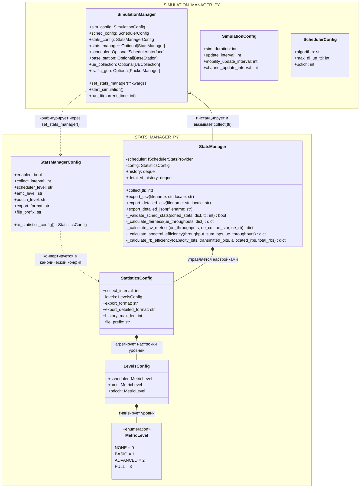
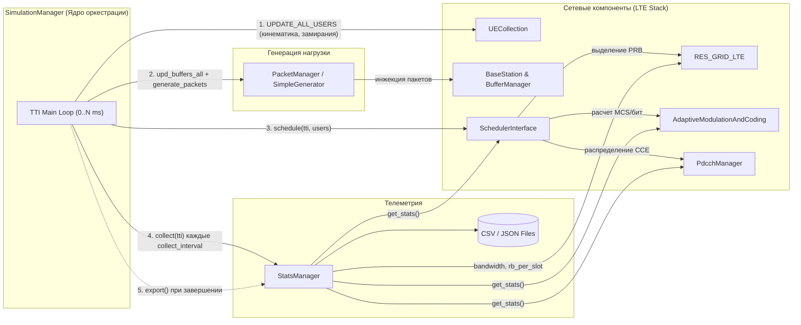

# Инженерная спецификация реализации OPT-SIM-002: Архитектурная декомпозиция SIMULATION_MANAGER, выделение StatsManager и спецификация межмодульных контрактов

> **Тип документа:** Архитектурная и инженерная спецификация реализации (Implementation Spec)  
> **Ответственный:** Стаценко А. (`SIMULATION_MANAGER.py`)  
> **Целевые файлы:**
> - `PyScheduler/STATS_MANAGER.py` (создание нового модуля)
> - `PyScheduler/SIMULATION_MANAGER.py` (рефакторинг оркестратора)
> - `PyScheduler/tests/simulation_manager_tests/test_stats_manager.py` (создание набора модульных тестов)  
> **Статус:** Согласовывается с куратором

---

## 1. Контекст, проблемы AS-IS и архитектурные цели TO-BE

### 1.1. Анализ дефектов и ограничений архитектуры AS-IS

В текущем состоянии файл `PyScheduler/SIMULATION_MANAGER.py` представляет собой монолит объемом 1538 строк. В нем нарушен принцип единственной ответственности (**Single Responsibility Principle, SRP**), объединяя две разнородные подсистемы:
1. **Оркестратор симулятора (`SimulationManager`)**: создание и привязка сущностей радиоинтерфейса LTE (`BaseStation`, `UECollection`, `RES_GRID_LTE`, `SchedulerInterface`), генераторов трафика (`PacketManager` / `SimpleGenerator`), управление дискретным тактовым циклом TTI (0..N мс), обновление кинематики абонентов и визуализация прогресса (`tqdm`).
2. **Аналитическая система сбора и экспорта телеметрии (`StatsManager`)**: опрос внутренних структур планировщика, AMC и PDCCH, расчет сложных агрегированных метрик (Jain's Fairness Index, Coefficient of Variation, Spectral Efficiency, RB Utilization/Wasted/Idle), поддержка кольцевых буферов истории и экспорт в CSV/JSON с учетом локали (`ru` / `en`).

#### Критические дефекты текущей реализации:
* **AUD-002 (Задвоение вызовов сбора метрик):** В цикле `start_simulation()` вызов `self.stats_manager.collect(tti)` выполняется дважды за один такт: на строке :1293 (сразу после шага `run_tti`) и повторно на строке :1324. Это приводит к дублированию каждой временной метки в результирующем CSV-файле, ломает расчеты среднеквадратичных отклонений и удваивает нагрузку на память.
* **AUD-001 (Блокировка запуска без файла лога):** Из-за дефекта отступов (синтаксической вложенности) строки :1180–1354 метода `start_simulation()` находятся внутри блока `if self._to_file:`. При штатном запуске с `to_file=False` симуляция завершается мгновенно за 0 TTI, а `StatsManager` даже не инстанциируется.
* **Дублирование и рассогласование классов конфигурации:** В файле сосуществуют два несвязанных класса: `StatisticsConfig` (строки 80–106) с полями `levels: LevelsConfig` и `StatsManagerConfig` (строки 894–916) со строковыми полями `scheduler_level: str`, `amc_level: str`. В методе `set_stats_manager()` изменяется второй, а затем в `start_simulation()` процедурно перекладывается в первый через словарь-маппер.
* **Высокая степень зацепления (Tight Coupling):** `StatsManager` напрямую обращается к приватным/внутренним полям планировщика (`self.scheduler.amc.get_stats()`, `self.scheduler.pdcch_manager.get_stats()`, `self.scheduler.lte_grid.bandwidth`, `self.scheduler.lte_grid.rb_per_slot`). Отсутствует явный контракт данных, что делает невозможным модульное тестирование `StatsManager` без подъема тяжелого графа зависимостей симулятора.

---

### 1.2. Архитектурные цели и принципы декомпозиции TO-BE

1. **Физическая декомпозиция (SRP):** Выделение `StatsManager`, перечислений уровней сбора и конфигурационных структур в самостоятельный модуль `PyScheduler/STATS_MANAGER.py` (~790 строк). Модуль `SIMULATION_MANAGER.py` сокращается до ~650 строк и фокусируется исключительно на оркестрации жизненного цикла симуляции.
2. **Инверсия зависимостей и формализация контрактов (DIP / ISP):** `StatsManager` перестает зависеть от конкретной реализации планировщика LTE. 
3. **100% обратная совместимость:** Все существующие пользовательские сценарии (`TEST_MODULES.py`, внешние интеграционные скрипты, `PLOT_METRICS.py`) продолжают работать без модификаций благодаря реэкспорту из `SIMULATION_MANAGER.py` через `__all__`.
4. **Изолированная тестируемость:** Возможность полного прогона тестов сбора, валидации, расчета аналитики и экспорта через легковесные Mock/Stub-объекты со скоростью выполнения < 0.2 секунды.

---

### 1.3. Архитектурная схема взаимодействия модулей



---

## 2. Детальная проработка выделения StatsManager

### 2.1. Структура нового модуля `PyScheduler/STATS_MANAGER.py`

Новый модуль организуется без циклических зависимостей, импортируя только стандартные библиотеки Python и `numpy`:

```python
"""
Модуль: STATS_MANAGER - Телеметрия, аналитика и экспорт метрик LTE-симуляции.
"""
from collections import deque
import csv
from dataclasses import dataclass, field
from enum import IntEnum
import json
from typing import Any, Dict, List, Optional, Protocol, runtime_checkable
import warnings

import numpy as np
```

---

### 2.2. Система уровней детализации и модели конфигурации

#### 2.2.1. `MetricLevel` (Уровни глубины опроса)
Перечисление `MetricLevel(IntEnum)` определяет гранулярность сбора метрик для каждого функционального узла (`scheduler`, `amc`, `pdcch`):
* `NONE = 0`: Опрос отключен. Нагрузка на память и CPU: **0% overhead**. Соответствующие методы `get_stats()` не вызываются.
* `BASIC = 1`: Агрегированные системные счетчики: число допущенных/активных UE, число выделенных RB, средние биты на RB, суммарная пропускная способность соты, общее время работы планировщика (`sch_total_time_us`), CCE allocations.
* `ADVANCED = 2`: Расчетные статистические характеристики соты:
  - Утилизация PRB и CCE в процентах;
  - Метрики разброса (min, max, avg, std) для приоритетов планировщика, CQI, SINR и пропускной способности абонентов;
  - Эффективность использования частотных ресурсов (RB Utilization, Wasted RBs, Idle RBs);
  - Спектральная эффективность (системная, средняя на UE, пиковая в bps/Hz);
  - Коэффициенты вариации (CV %);
  - Индекс справедливости распределения ресурсов (Jain's Fairness Index).
* `FULL = 3`: Полный поабонентный лог (per-UE granularity). Формирует снимки в кольцевой буфер `detailed_history` с детализацией по каждому активному `UE_ID`: мгновенный CQI, subband CQI, SINR, число RB, CCE, throughput bps, объем буфера в байтах, переданные биты.

#### 2.2.2. Датаклассы конфигурации и их унификация

```python
@dataclass
class LevelsConfig:
    """Конфигурация уровней детализации per-подсистема."""
    scheduler: MetricLevel = MetricLevel.BASIC
    amc: MetricLevel = MetricLevel.BASIC
    pdcch: MetricLevel = MetricLevel.BASIC


@dataclass
class StatisticsConfig:
    """Каноническая внутренняя конфигурация StatsManager."""
    collect_interval: int = 10
    levels: LevelsConfig = field(default_factory=LevelsConfig)
    export_format: str = "csv"
    export_detailed_format: str = "csv"
    history_max_len: int = 10000
    file_prefix: str = "lte_stats"

    def __post_init__(self):
        if self.levels is None:
            self.levels = LevelsConfig()
        if self.export_detailed_format not in ("csv", "json"):
            raise ValueError(f"Недопустимый export_detailed_format: {self.export_detailed_format}")
        if self.collect_interval <= 0:
            raise ValueError("collect_interval должен быть строго положительным целым числом")


@dataclass
class StatsManagerConfig:
    """
    Фасадный конфигуратор для сохранения полной обратной совместимости
    с методом SimulationManager.set_stats_manager(**kwargs).
    """
    enabled: bool = True
    collect_interval: int = 10
    scheduler_level: str = "basic"
    amc_level: str = "basic"
    pdcch_level: str = "none"
    export_format: str = "csv"
    export_detailed_format: str = "csv"
    file_prefix: str = "manager_stats"
    history_max_len: int = 10000

    def to_statistics_config(self) -> StatisticsConfig:
        """Конвертирует фасадную строковую конфигурацию в строгий канонический объект."""
        level_map = {
            "none": MetricLevel.NONE,
            "basic": MetricLevel.BASIC,
            "advanced": MetricLevel.ADVANCED,
            "full": MetricLevel.FULL,
        }
        return StatisticsConfig(
            collect_interval=self.collect_interval,
            levels=LevelsConfig(
                scheduler=level_map.get(self.scheduler_level.lower(), MetricLevel.BASIC),
                amc=level_map.get(self.amc_level.lower(), MetricLevel.BASIC),
                pdcch=level_map.get(self.pdcch_level.lower(), MetricLevel.NONE),
            ),
            export_format=self.export_format,
            export_detailed_format=self.export_detailed_format,
            file_prefix=self.file_prefix,
            history_max_len=self.history_max_len,
        )
```

---

### 2.3. Внутреннее состояние и организация буферов

`StatsManager` управляет двумя кольцевыми очередями `collections.deque`:
1. `self.history = deque(maxlen=self.config.history_max_len)`:
   - Содержит агрегированные снимки состояния соты на данном TTI (`dict`).
   - Используется для построения системных графиков пропускной способности, утилизации PRB и экспорта в `<file_prefix>.csv`.
   - Защищен от утечек памяти: при превышении `history_max_len` старейшие снимки автоматически вытесняются без накладных расходов.
2. `self.detailed_history = deque(maxlen=self.config.history_max_len)`:
   - Наполняется только при условии `levels.scheduler >= FULL` или `levels.amc >= FULL`.
   - Содержит вложенную структуру `{ "tti": int, "ue_metrics": { "<ue_id>": { ... } } }`.
   - Служит источником для экспорта в `<file_prefix>_detailed.csv` (развернутая поабонентная таблица) или `<file_prefix>_detailed.json`.

---


## 3. Спецификация контрактов получения метрик (Metric Ingestion Contracts)

В архитектуре AS-IS `StatsManager` был жестко завязан на объект планировщика. В TO-BE вводятся формальные контракты в виде протоколов (`typing.Protocol`), которые гарантируют типобезопасность и независимость.

### 3.1. Формальные протоколы провайдеров метрик

```python
@runtime_checkable
class ILteGridStatsProvider(Protocol):
    """Контракт доступа к параметрам частотно-временной сетки LTE."""
    bandwidth: float      # Полоса пропускания в МГц (напр., 10.0, 20.0)
    rb_per_slot: int      # Число ресурсных блоков в слоте (напр., 50, 100)


@runtime_checkable
class IAmcStatsProvider(Protocol):
    """Контракт модуля адаптивной модуляции и кодирования (AMC)."""
    def get_stats(self) -> Dict[str, Any]:
        ...


@runtime_checkable
class IPdcchStatsProvider(Protocol):
    """Контракт менеджера канала управления PDCCH."""
    def get_stats(self) -> Dict[str, Any]:
        ...


@runtime_checkable
class ISchedulerStatsProvider(Protocol):
    """Контракт основного планировщика MAC-уровня."""
    lte_grid: ILteGridStatsProvider
    amc: IAmcStatsProvider
    pdcch_manager: IPdcchStatsProvider

    def get_stats(self) -> Dict[str, Any]:
        ...
```

---

### 3.2. Словарь данных и схема собираемых метрик (Data Dictionary)

#### 3.2.1. Контракт `scheduler.get_stats() -> Dict[str, Any]`

| Поле | Тип | Обязательное | Описание и семантика | Значение по умолчанию |
|---|---|:---:|---|---|
| `tti` | `int` | **Да** | Номер такта TTI, на котором отработал планировщик. | — (валидируется) |
| `sch_eligible_ue_count` | `int` | **Да** | Число абонентов с непустым буфером, допущенных к планированию. | `0` |
| `sch_active_ue_count` | `int` | **Да** | Число абонентов, получивших хотя бы 1 RB в данном TTI. | `0` |
| `dl_rb_allocated_count` | `int` | **Да** | Суммарное количество распределенных PRB соты. | `0` |
| `dl_rb_per_ue_avg` | `float` | Нет | Среднее число PRB на одного активного абонента. | `0.0` |
| `buffer_size_sum_bytes` | `int` | Нет | Суммарный объем буферов всех допущенных UE (в байтах). | `0` |
| `sch_total_time_us` | `float` | Нет | Полное время исполнения алгоритма планирования (мкс). | `0.0` |
| `sch_priority_calc_time_us` | `float` | Нет | Время расчета метрик приоритета (мкс). | `0.0` |
| `sch_priority_sort_time_us` | `float` | Нет | Время сортировки очереди пользователей (мкс). | `0.0` |
| `dl_prb_utilization_pct` | `float` | Нет | Процент утилизации доступных PRB соты. | `0.0` |
| `sch_priority_list_size` | `int` | Нет | Размер сформированного списка приоритетов. | `0` |
| `sch_pdcch_blocked_count` | `int` | Нет | Число UE, заблокированных из-за исчерпания CCE PDCCH. | `0` |
| `sch_avg_priority_value` | `float` | Нет | Среднее значение приоритета в очереди. | `0.0` |
| `sch_priority_list` | `List[Dict]` | Нет | Список `[{"UE_ID": int, "priority": float}]`. | `[]` |
| `ue_buffer_sizes` | `Dict[int, int]` | Нет | Словарь `{ue_id: buffer_bytes}` на начало TTI. | `{}` |
| `ue_transmitted_bits` | `Dict[int, int]` | Нет | Словарь `{ue_id: bits}` переданных бит в данном TTI. | `{}` |

---

#### 3.2.2. Контракт `amc.get_stats() -> Dict[str, Any]`

| Поле | Тип | Обязательное | Описание и семантика | Значение по умолчанию |
|---|---|:---:|---|---|
| `dl_capacity_bits_sum_tti` | `int` | Нет | Предельная емкость выделенных RB по CQI (бит). | `0` |
| `dl_transmitted_bits_sum_tti` | `int` | Нет | Фактически переданные полезные биты за TTI. | `0` |
| `dl_throughput_sum_kbps` | `float` | Нет | Мгновенная пропускная способность соты (кбит/с). | `0.0` |
| `dl_bits_per_rb_avg` | `float` | Нет | Средняя спектральная плотность (бит на 1 RB). | `0.0` |
| `dl_cqi_wb_avg_idx` | `float` | Нет | Средний Wideband CQI по соте (1..15). | `0.0` |
| `dl_sinr_avg` | `float` | Нет | Средний SINR по соте (дБ). | `0.0` |
| `dl_ue_throughputs` | `Dict[int, float]` | Нет | Словарь `{ue_id: throughput_bps}`. | `{}` |
| `ue_cqi` | `Dict[int, int]` | Нет | Словарь `{ue_id: wideband_cqi_index}`. | `{}` |
| `ue_cqi_sbb` | `Dict[int, List[int]]`| Нет | Словарь `{ue_id: [subband_cqi]}`. | `{}` |
| `ue_sinr` | `Dict[int, float]` | Нет | Словарь `{ue_id: sinr_db}`. | `{}` |
| `ue_rb_allocated` | `Dict[int, int]` | Нет | Словарь `{ue_id: rb_count}`. | `{}` |

---

#### 3.2.3. Контракт `pdcch_manager.get_stats() -> Dict[str, Any]`

| Поле | Тип | Обязательное | Описание и семантика | Значение по умолчанию |
|---|---|:---:|---|---|
| `pdcch_cce_total_count` | `int` | Нет | Общее число доступных CCE в текущем TTI. | `0` |
| `pdcch_cce_allocated_count` | `int` | Нет | Число фактически распределенных CCE под DCI. | `0` |
| `pdcch_cce_utilization_pct` | `float` | Нет | Процент утилизации CCE (`allocated / total * 100`). | `0.0` |
| `pdcch_ue_cce_allocations` | `Dict[int, int]` | Нет | Словарь `{ue_id: cce_count}` по абонентам. | `{}` |

---

### 3.3. Протокол валидации входных данных и обработка аномалий

Метод `_validate_sched_stats(sched_stats: dict, tti: int) -> bool` предотвращает повреждение телеметрии:
1. **Проверка обязательных ключей:** Проверяется присутствие полей `tti`, `sch_eligible_ue_count`, `sch_active_ue_count`, `dl_rb_allocated_count`. При отсутствии любого из полей генерируется `warnings.warn(..., UserWarning)` и сбор для текущего TTI отменяется (`return False`).
2. **Проверка рассинхронизации времени (TTI Mismatch):** Сравнивается ожидаемый такт `tti` симулятора и метка `sched_stats["tti"]`. В случае расхождения (например, если планировщик пропустил шаг или вернул кэшированные данные предыдущего такта):
   ```python
   if sched_stats["tti"] != tti:
       warnings.warn(
           f"[StatsManager] TTI mismatch: ожидался {tti}, получен {sched_stats['tti']}. "
           f"Пропуск сбора снимка.",
           UserWarning
       )
       return False
   ```
3. **Безопасное извлечение числовых значений:** Все обращения к метрикам внутри `collect()` выполняются через метод `.get(key, default)` с безопасными типами (`0`, `0.0`, `{}`), гарантируя отсутствие необработанных `KeyError`.

---

## 4. Взаимодействие ядра (`SimulationManager`) с другими компонентами

### 4.1. Граф зависимостей компонентов симулятора



---

### 4.3. Устранение сопутствующих дефектов ядра в рамках рефакторинга

При разделении модулей в `SIMULATION_MANAGER.py` устраняются два критических дефекта:

#### 1. Устранение ошибки отступа (AUD-001):
Блок `if self._to_file:` теперь ограничивается только настройкой перенаправления потоков. Валидация параметров, создание ресурсной сетки, инициализация `StatsManager` и цикл TTI выносятся на базовый уровень метода:

```python
# ДО (AS-IS): Всё тело метода спрятано под if self._to_file:
if self._to_file:
    self._log_file = open(...)
    self._check_required_parameters()
    # ... весь цикл симуляции с отступом 12-16 пробелов

# ПОСЛЕ (TO-BE): Изолированная настройка логирования + безусловное исполнение
if self._to_file:
    self._log_file = open("output.txt", "w", buffering=1, encoding="utf-8")
    self._original_stdout = sys.stdout
    self._original_stderr = sys.stderr
    sys.stdout = self._log_file
    sys.stderr = self._log_file
    self._return_stdout = True

# Безусловный запуск симуляции (отступ 8 пробелов):
self._check_required_parameters()
num_frames = int(np.ceil(self.sim_config.sim_duration / 10))
# ... инициализация сетки, планировщика, StatsManager и цикл
```

#### 2. Ликвидация стопроцентного задвоения сбора метрик (AUD-002):
В основном цикле удаляется повторный вызов `self.stats_manager.collect(tti)` на строке :1324:

```python
# ДО (AS-IS):
pbar.update(1)
if self.stats_manager and (tti % self.stats_manager.config.collect_interval == 0):
    self.stats_manager.collect(tti)  # ПЕРВЫЙ ВЫЗОВ (:1293)
# ... обновление sbar ...
if self.stats_manager and tti % self.stats_manager.config.collect_interval == 0:
    self.stats_manager.collect(tti)  # ВТОРОЙ ДУБЛИРУЮЩИЙ ВЫЗОВ (:1324)!

# ПОСЛЕ (TO-BE):
pbar.update(1)
if self.stats_manager and (tti % self.stats_manager.config.collect_interval == 0):
    self.stats_manager.collect(tti)  # ЕДИНСТВЕННЫЙ ЛЕГИТИМНЫЙ ВЫЗОВ
```

---
