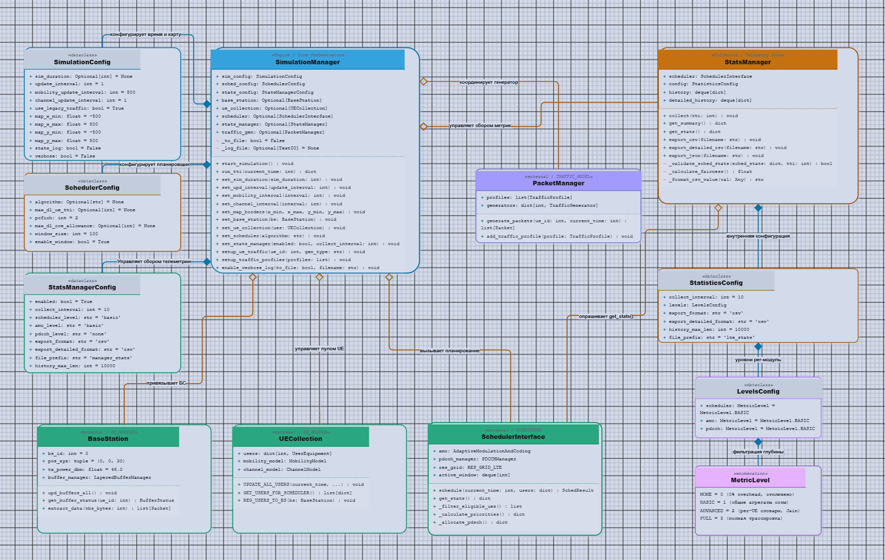
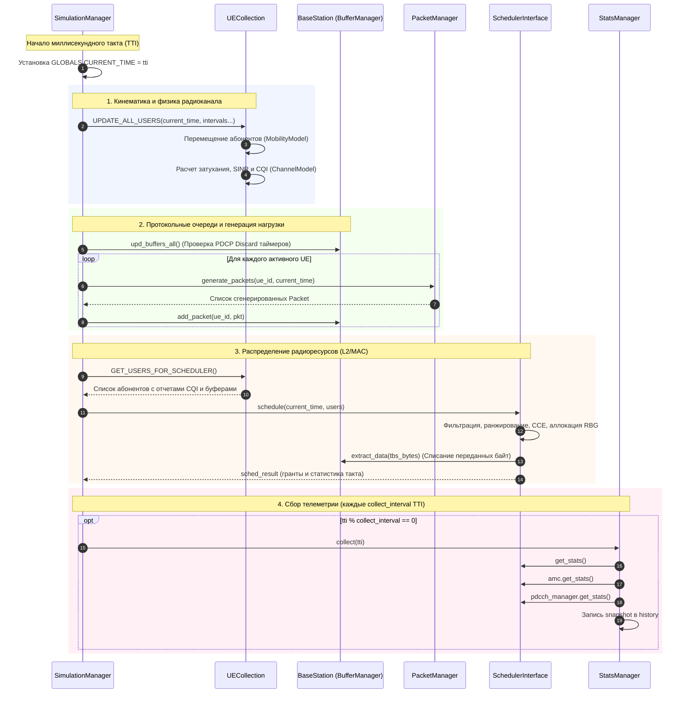

# Диаграммы модуля Simulation Manager и Тестовый комплекс

## 1. Текущая структура 
Показана структура взаимодействия модулей работы в `Simulation_manager`

> Актуальный файл с редактора Drawio для удоства изучения [docs/Simulator_manager.drawio](docs/Simulator_manager.drawio).

## 2. Типовой сценарий (AS-IS)
Сценарий: Исполнение единичного миллисекундного такта TTI (1 мс) внутри главного цикла `start_simulation()` при вызове `run_tti(current_time)`.

